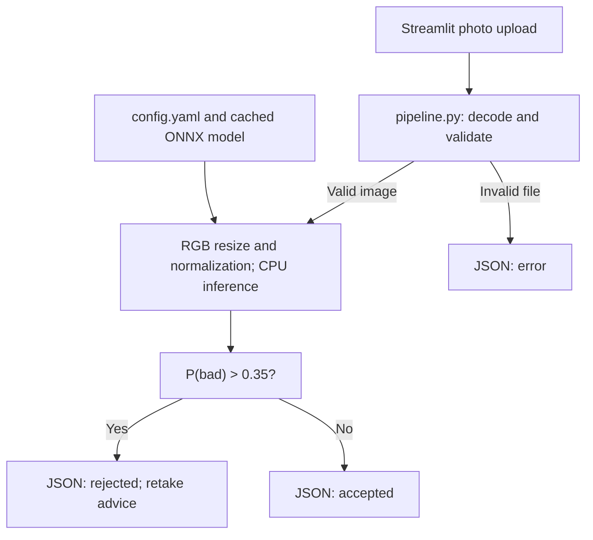

# Lab 7 — Document Quality Gate

Ekaterina Shigarova · IIKb-24 · Semester 1

**Public website:** https://document-quality-classification.onrender.com

Upload a JPG or PNG, click **Check photo**, and inspect the decision, confidence, processing time and downloadable JSON.

## Scope and architecture

Following the instructor's clarification, this semester implements the **good/bad quality gate only**. INN/SNILS/PASSPORT classification is deferred to the next semester. Both document-type fields remain `null`, including for accepted images.



The app caches one `DocumentPipeline` with `st.cache_resource`; requests reuse the model session. Model paths resolve relative to the configuration file. Uploaded image bytes are processed in memory and are not written to disk by the app.

## Files

| Path within lab7 | Purpose |
| --- | --- |
| `pipeline.py` | Validation, preprocessing, ONNX inference and JSON contract |
| `config.yaml` | Model path, threshold, CPU settings and input limits |
| `models/model.onnx` | EfficientNet-B0, fine-tuned checkpoint from epoch 28 |
| `app_streamlit.py` | Public website using the same pipeline |
| `requirements.txt` | Inference, interface and test dependencies |
| `tests/test_pipeline.py` | Ten automated tests |
| `samples/` | Twenty fixed validation images and two invalid files; provenance in `manifest.json` |
| `predictions.json` | Recorded batch results |
| `latency_report.json`, `pytest_output.txt` | Recorded local validation evidence |
| `model_card.md`, `retrospective.md` | Model details and integration reflection |

The committed model and samples are sufficient for inference and these tests. The full training dataset is not needed. Training reproduction is described in the repository's root README and Lab 6 reports.

## Run locally

Use Python **3.11.9**. Download or clone the repository, then open a terminal at its root. On Windows, run each command separately:

```powershell
py -3.11 -m venv .venv_quality
```

```powershell
.\.venv_quality\Scripts\python.exe -m pip install -r .\lab7\requirements.txt
```

```powershell
.\.venv_quality\Scripts\python.exe .\lab7\pipeline.py --check-model
```

```powershell
.\.venv_quality\Scripts\python.exe -m streamlit run .\lab7\app_streamlit.py
```

Open the local URL printed by Streamlit. Linux/macOS equivalents use `python3 -m venv .venv_quality` and `.venv_quality/bin/python` instead of the Windows interpreter path.

To obtain JSON directly:

```powershell
.\.venv_quality\Scripts\python.exe .\lab7\pipeline.py .\lab7\samples\07_good_inn_118_v1.jpg
```

Dependencies are constrained in `requirements.txt`; this is not a complete transitive dependency lock. PyTorch and training packages are unnecessary for this ONNX application.

## Run tests

From the repository root:

```powershell
.\.venv_quality\Scripts\python.exe -m pytest .\lab7\tests\test_pipeline.py -q --capture=tee-sys
```

The suite checks schema, acceptance, glare rejection, corrupted images, renamed text, CPU latency, a configuration threshold change, batch counts, missing models and session reuse. It rewrites `lab7/predictions.json` and `lab7/latency_report.json`; keep a copy first if retaining the submitted measurements.

Recorded result: **10 passed in 2.34 seconds**. Batch counts: **10 accepted, 10 rejected, 2 error**. The 20-image CPU benchmark used 20 warm-up requests, batch size 1, and achieved mean **19.11 ms**, median **18.82 ms**, P95 **21.84 ms**, below the required mean of 500 ms.

These are Windows laptop measurements on an AMD Ryzen 7 5800U, including reading, decoding, preprocessing, inference and creation of a JSON-ready result. They exclude model startup and network/UI transfer. The fixed validation samples are integration fixtures, not an independent accuracy evaluation.

## Decision and JSON contract

The ONNX output is `P(good)`. The pipeline calculates `P(bad) = 1 - P(good)` and **rejects only when `P(bad) > 0.35`**. The threshold comes from Lab 6 Task 5B validation-only selection.

Every image response contains `file`, `status`, `quality`, `quality_confidence`, `document_type`, `document_type_confidence`, `reason`, `model_versions`, `latency_ms` and a UTC `timestamp`. Status is `accepted`, `rejected` or `error`. Error responses have null quality/confidence; document-type fields are always null. The quality version is `efficientnetb0_finetune_top30_onnx_fp32_epoch28`, and the doctype version is `deferred_next_semester`.

Confidence is the uncalibrated model probability for the returned label, not measured accuracy. A rejected boundary case can have confidence below 50% because the operating threshold is 35%. A rounded display of 100.0% is not certainty.

JPG/PNG content is validated, with a 20 MiB byte limit and 25-million-pixel limit. Corrupted/non-image input and model/configuration failures return structured errors without exposing a traceback.

## Redeploy on Render

Connect the GitHub repository as a **Web Service** and use:

| Setting | Value |
| --- | --- |
| Repository | `EkaterinaShigarova/document-quality-classification` |
| Branch | `main` |
| Language | Python 3 |
| Root Directory | `lab7` |
| Build Command | `pip install -r requirements.txt` |
| Start Command | `python -m streamlit run app_streamlit.py --server.address 0.0.0.0 --server.port $PORT --server.headless true --server.maxUploadSize 20` |
| Environment variable | `PYTHON_VERSION=3.11.9` |
| Compute plan | Free |

Deploy and wait for **Live**. The model is committed under `lab7/models`; no model-download token is needed. Root Directory makes commands run from `lab7`. Render supplies `$PORT`.

The free instance sleeps when idle, so reopening can involve a cold-start delay. Before the classroom demonstration, open the public URL and complete one request. Platform availability and free-plan limits can change; see [Render web services](https://render.com/docs/web-services), [Python versions](https://render.com/docs/python-version) and [free-service limits](https://render.com/docs/free).

## Public verification and submission

On 21 November 2026, the deployed website accepted `07_good_inn_118_v1.jpg`, rejected `19_bad_inn_blur_281_v2.jpg` and displayed a readable error for `corrupted.png`. Two observed server processing times were 176.5 ms and 357.4 ms; these are individual requests, not a hosted benchmark mean or network round-trip time.

A screen recording demonstrates live accepted/rejected requests and JSON at the public URL. Supply that recording with the submission. The final submission also requires the repository tag `final` and a live classroom demonstration; neither is replaced by screenshots or this README.

See the [model card](model_card.md) for metric provenance and limitations, and the [retrospective](retrospective.md) for integration lessons.
