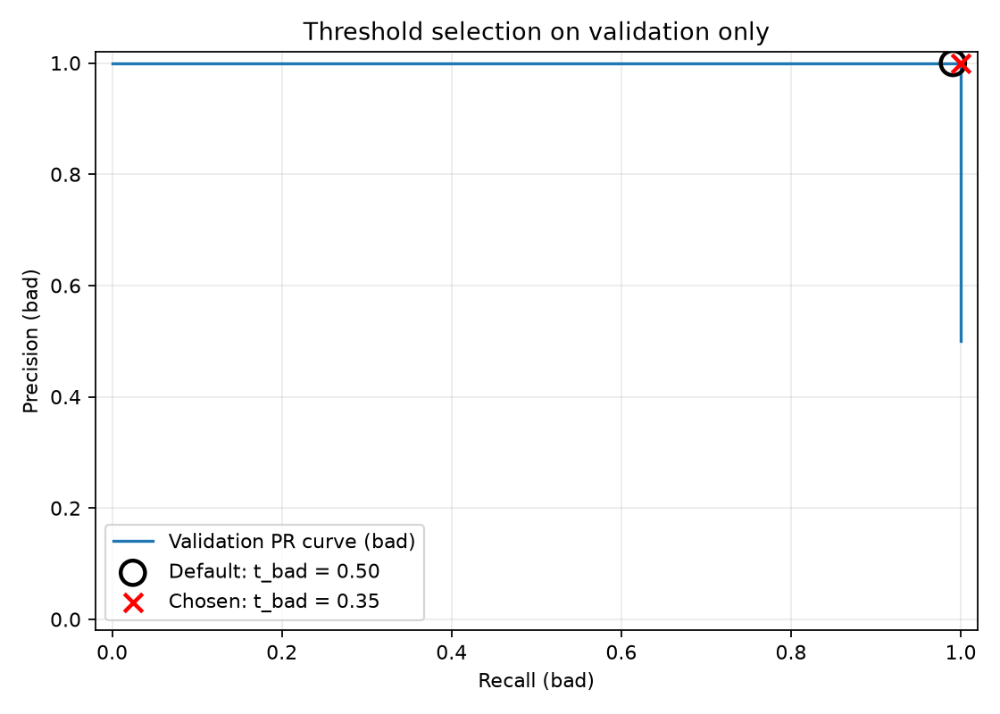

# Threshold and Cost Analysis

I used the saved fine-tuned EfficientNet-B0 checkpoint from Task 5A. No training was performed. Threshold selection used only 216 validation images (108 bad, 108 good). Test images and test predictions were not read.

The model sigmoid output is P(good); P(bad) = 1 - P(good). I reject an image as bad when P(bad) > t_bad; otherwise it is good. The strict comparison preserves the original default decision, including ties at 0.5. All 17 thresholds from 0.10 to 0.90 in steps of 0.05 were evaluated for bad-class precision, recall and F1.

A false accept passes a poor-quality document to OCR or later processing, risking incorrect extracted data and later rework. A false reject asks for another photo or manual review of a usable image. I assume costs of 5 units per false accept and 1 per false reject. These are hypothetical relative costs, not measured money or operator time. The rule minimizes 5 * false_accepts + 1 * false_rejects. Ties prefer higher bad-class F1, then proximity to 0.5, higher bad recall, and finally the lower threshold. The rule and costs are set before inspecting the sweep.

| Validation measure | Default t_bad = 0.50 | Chosen t_bad = 0.35 |
|---|---:|---:|
| Bad precision | 1.0000 | 1.0000 |
| Bad recall | 0.9907 | 1.0000 |
| Bad F1 | 0.9953 | 1.0000 |
| False accepts | 1 | 0 |
| False rejects | 0 | 0 |
| Weighted cost | 5.0000 | 0.0000 |

Expected counts per 216 images with a similar class mix are the validation counts above. Rescaled to 1,000 images, false accepts change from 4.6 to 0.0, and false rejects from 0.0 to 0.0. These are sample-based estimates, not deployment guarantees. I recommend the selected threshold for a prototype under the stated cost assumption. This threshold has no independent test evaluation in Task 5B. Synthetic validation performance and the assumed costs may not transfer to real document photos.

Sweep table: ../results/efficientnetb0_threshold/threshold_sweep.csv

Reference: https://scikit-learn.org/stable/modules/generated/sklearn.metrics.precision_recall_curve.html
