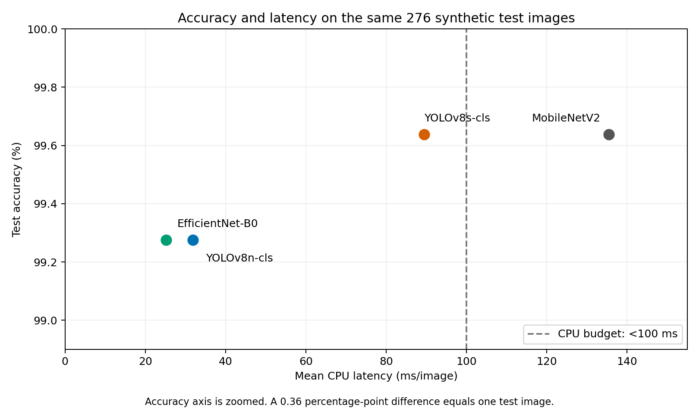
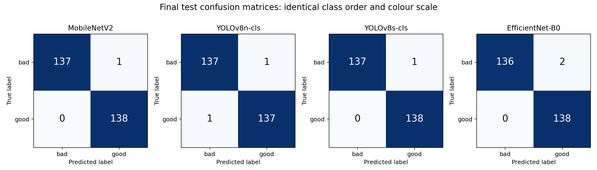

# Full Model Comparison

This table is generated from the four experiment results.json files. Precision, recall and F1 are macro averages. All runs use the same 276 test images and metadata hash.

| Model | Accuracy | Precision | Recall | F1 | Latency (ms/image) | Size (MB) | Parameters | Training (min) | Epochs |
|---|---:|---:|---:|---:|---:|---:|---:|---:|---:|
| MobileNetV2 | 99.64% | 0.996403 | 0.996377 | 0.996377 | 135.49 | 10.28 | 2,422,081 | 26.75 | 37 |
| YOLOv8n-cls | 99.28% | 0.992754 | 0.992754 | 0.992754 | 31.85 | 2.96 | 1,440,850 | 32.87 | 8 |
| YOLOv8s-cls | 99.64% | 0.996403 | 0.996377 | 0.996377 | 89.41 | 10.26 | 5,083,298 | 98.82 | 10 |
| EfficientNet-B0 | 99.28% | 0.992857 | 0.992754 | 0.992753 | 25.22 | 16.31 | 4,008,829 | 60.97 | 50 |

## Quality-gate errors and acceptance criteria

False accept means bad predicted good. False reject means good predicted bad.

| Model | Bad recall | False accepts | False rejects | Passes all thresholds |
|---|---:|---:|---:|---|
| MobileNetV2 | 99.28% | 1 | 0 | No |
| YOLOv8n-cls | 99.28% | 1 | 1 | Yes |
| YOLOv8s-cls | 99.28% | 1 | 0 | Yes |
| EfficientNet-B0 | 98.55% | 2 | 0 | Yes |

## Selection using the preregistered rule

EfficientNet-B0 is selected for the initial CPU quality gate. It passes all screening thresholds. Among passing models whose macro F1 is within 0.01 of the highest value, it has the lowest measured latency. This is a selection for the synthetic-data prototype, pending real-photo testing.

## Protocol and limits

The actual split is 1,308 train, 216 validation and 276 test images. It comes from source-level sampling with 70/15/15 probabilities. Related variants stay together. Models use seed 24500007, maximum 50 epochs, patience 5 and batch size 32.

MobileNetV2 and EfficientNet-B0 use frozen bases and 224 x 224 inputs. Both YOLO variants use full fine-tuning and 640 x 640 inputs. Architecture, input size, head design, framework and training regime therefore all contribute to the measured differences.

CPU latency uses batch size 1, 20 warm-up predictions and 100 timed predictions. It includes resizing, preprocessing, inference and the decision. Decoding, disk access, model loading and network operations are excluded. The recorded CPU is the same, with four intra-op threads and one inter-op thread. These are single timing measurements and do not establish a stable ranking across different system loads or machines.

Saved sizes describe inference.keras for MobileNetV2, optimizer-stripped best.pt for YOLO and a float32 state_dict checkpoint for EfficientNet-B0. Formats and stored precision differ. File size is not runtime memory usage. MB means 1,000,000 bytes.

EfficientNet-B0 passes the speed budget but accepts two bad images, compared with one for each YOLO variant. Its speed advantage over nano is approximately 6.63 ms per image. Error cost remains relevant even when the screening thresholds pass. No real-photo evaluation is available.

## Figures

