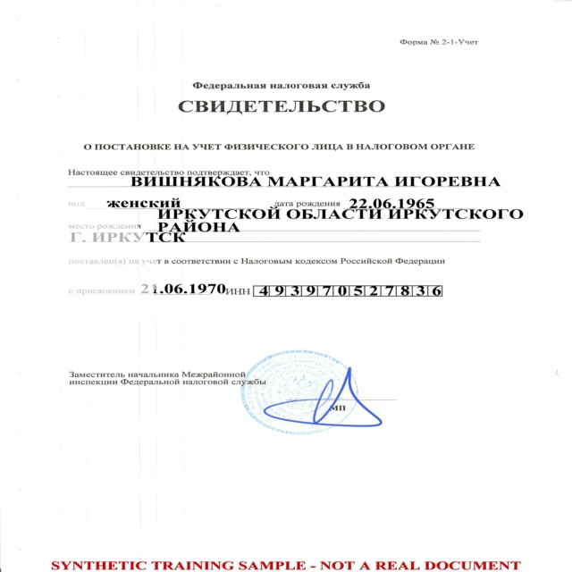
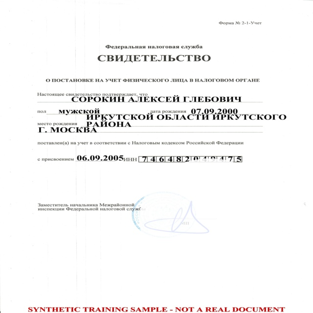
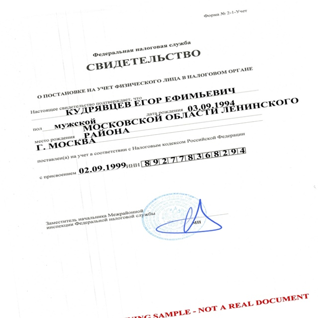
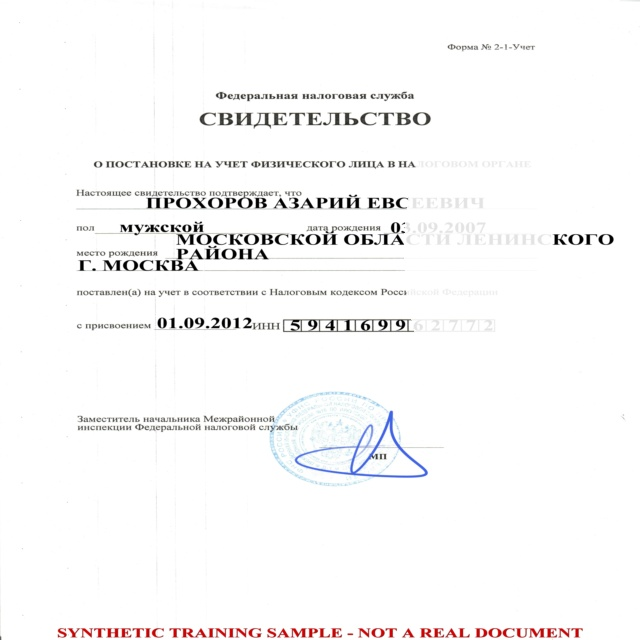

# Error Analysis and Failure Gallery

Student: Ekaterina Shigarova, IIKb-24. Task 4. Seed: 24500007.

## What was checked

I inspected the test confusion matrices, saved test predictions and the misclassified images. The same 276 test images contain 138 good and 138 bad examples. The bad examples include 29 blur, 28 glare, 26 skew, 26 occlusion and 29 exposure images. These counts come from the test records in metadata.jsonl.

| Model | All errors | Bad predicted good | Good predicted bad | Dominant failure defect | Glare images correctly rejected |
|---|---:|---:|---:|---|---:|
| MobileNetV2 | 1 | 1 | 0 | Glare | 27/28 (96.43%) |
| YOLOv8n-cls | 2 | 1 | 1 | Glare among defective images; one good-image rejection | 27/28 (96.43%) |
| YOLOv8s-cls | 1 | 1 | 0 | Glare | 27/28 (96.43%) |
| EfficientNet-B0 | 2 | 2 | 0 | Glare | 26/28 (92.86%) |

Glare rejection here means the proportion of glare-labelled bad images predicted bad. It is not an F1 score for a separately trained glare class. No test errors were found for blur, skew, occlusion or exposure in these runs. The small number of examples does not prove that those defects are solved on real photographs.

## Failure gallery

The images below remain in the corresponding results/<experiment>/errors/ folders. Each entry gives the real label and the prediction. Repeated images across models are shown because they are separate model errors.

### MobileNetV2

True: **bad**. Predicted: **good**. Defect: glare. Image: bad_inn_glare_182_v2.jpg.

### YOLOv8n-cls

True: **bad**. Predicted: **good**. Defect: glare. Image: bad_inn_glare_222_v3.jpg.

True: **good**. Predicted: **bad**. No bad-image defect label. Image: good_inn_111_v3.jpg. This is an unnecessary rejection; I cannot establish its cause from the predicted label alone.

### YOLOv8s-cls

True: **bad**. Predicted: **good**. Defect: glare. Image: bad_inn_glare_222_v3.jpg.

### EfficientNet-B0

True: **bad**. Predicted: **good**. Defect: glare. Image: bad_inn_glare_242_v2.jpg. A bright area washes out parts of the printed fields, although much of the document remains visible.

True: **bad**. Predicted: **good**. Defect: glare. Image: bad_inn_glare_182_v2.jpg. Some labels and text are faded. This image was also missed by MobileNetV2.

These visual observations do not establish why the networks made their decisions. No OCR experiment or explanation method was run.

## Hardest defect and proposed changes

Glare is the hardest defect in these test results: all five false-accept events across the four models are glare-labelled INN images. There are six model-image error events in total, involving four distinct photographs. The two YOLO variants miss the same glare image; EfficientNet and MobileNetV2 share a different one. These repeated errors are not independent evidence from six different photographs.

I would add more varied glare augmentation to the training set, with different positions, shapes and brightness levels, especially over important text fields. I would check borderline labels so that the distinction between good and bad follows a consistent readability rule. I would also collect real photographs with reflections and keep a separate real-photo evaluation set. Threshold changes would be selected on validation data and evaluated once on an untouched test set. These are proposed next steps; they were not applied to the reported runs.

## EfficientNet-B0 learning curves

The base was frozen, with 1,281 trainable parameters in the new binary head. Training used all 50 planned epochs. Training loss decreased from 0.5773 to 0.0798, while validation loss decreased from 0.4815 to 0.0747. The lowest validation loss was at epoch 50, so this checkpoint was used for the test evaluation. The curves remain close and do not show a sustained rise in validation loss that would indicate strong overfitting. This observation concerns this synthetic split only.

The final test accuracy is 274/276 = 99.28%, macro F1 is 0.992753 and bad recall is 136/138 = 98.55%. All 138 good test images were accepted. Both mistakes are false accepts, which matter because unsuitable photographs could continue to OCR.

## Requirement that remains unresolved

The task requests at least five misclassified images per model. These runs produced only 1, 2, 1 and 2 errors, so the gallery contains every actual error and cannot meet that count on the fixed test split. I have not duplicated errors within a model or relabelled correct predictions as failures. An instructor decision about this shortfall is needed before treating the gallery requirement as satisfied. Additional evaluation would need a clearly separated protocol and must not silently replace the original test results.
